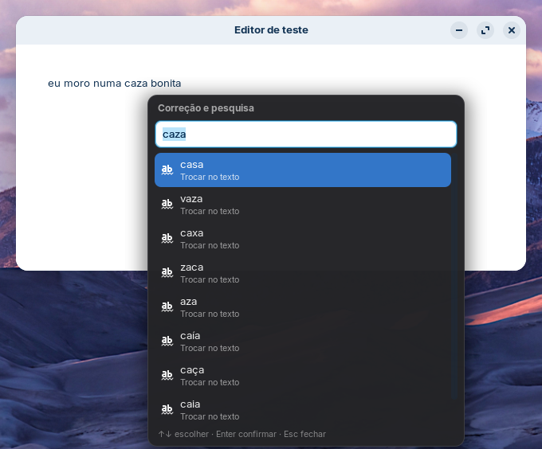
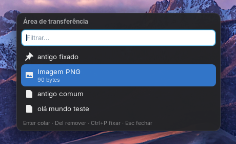
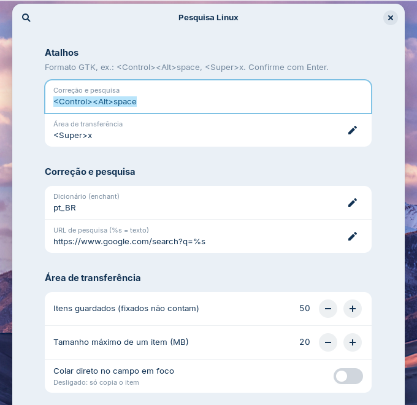

# Balão

Extensão do GNOME Shell que abre um **balão flutuante interativo** onde você está digitando (ou onde está o
mouse) com **correção ortográfica**, **pesquisa no navegador** e **histórico da área de transferência**.
O balão não fica preso num canto da tela: ele aparece junto do cursor de texto, em qualquer aplicativo.

<p align="center">
  
</p>

## Recursos

**Correção e pesquisa** — `Ctrl+Alt+Espaço`
- Pega a palavra sob o cursor (ou o texto selecionado) e sugere correções com o dicionário pt_BR.
- Escolher uma sugestão **troca a palavra direto no aplicativo**.
- O item *Pesquisar* abre o texto no navegador padrão (Google, ou a URL que você configurar).
- Fora de um campo de texto, o balão abre no mouse e já vem com o texto selecionado na tela.

**Histórico da área de transferência** — `Super+X`
- Guarda tudo o que você copia: texto, imagens, arquivos e outros formatos. O que não é texto aparece com um ícone.
- Ao escolher um item, ele volta para a área de transferência e é **colado no campo em foco**.
  Depois disso, o `Ctrl+V` comum também cola o item.
- Filtro por digitação (ignora acentos), itens fixados no topo, remoção individual.
- Ignora o que vem de gerenciadores de senha (KeePassXC e outros que marcam a cópia como senha).
- Na primeira execução, importa o histórico da extensão
  [Clipboard Indicator](https://github.com/Tudmotu/gnome-shell-extension-clipboard-indicator), se você a usava.

<p align="center">
  
</p>

### Teclas dentro do balão

| Tecla | Ação |
|---|---|
| `↑` `↓` `Tab` `PgUp` `PgDn` | Navegar na lista (o mouse também seleciona) |
| `Enter` ou clique | Confirmar |
| `Esc`, clique fora ou o mesmo atalho | Fechar |
| `Del` | Remover o item do histórico |
| `Ctrl+P` | Fixar ou desafixar o item do histórico |
| Arrastar o título | Mover o balão |

## Integração com o Nexus (opcional)

Com o [Nexus](https://github.com/JvFontenele/nexus) instalado, ligue **Preferências → Usar o Nexus**. O Balão passa a ser o rosto do Nexus no GNOME:

- **Notch no topo da tela** com o mascote Nexo.
  - Fica escondido e desce quando você empurra o mouse contra o topo, ou com `Super+Shift+N`.
  - Mostra o dispositivo e seis controles: espelhar a tela, áudio do PC no celular, enviar arquivo, copiar no celular, pesquisar no celular e permissões.
  - Pedidos de pareamento e o progresso de arquivos aparecem nele sem pegar o teclado.
- **Balão principal:** ganha "Enviar para…", "Pesquisar no…", "Espelhar tela do…" e "Áudio do PC no…".
- **Histórico (`Super+X`):** o texto que chega do celular entra no histórico, e `Ctrl+E` envia ao celular o texto ou os arquivos copiados.
- **Atalho `Super+Shift+M`:** espelha a tela do celular (scrcpy).

Sem o Nexus, nada disso aparece e o Balão funciona como antes.

## Requisitos

- **GNOME Shell 46** em sessão **Wayland**. Desenvolvido no Zorin OS 18 (base Ubuntu 24.04).
- `enchant-2` e o dicionário hunspell do idioma:
  ```bash
  sudo apt install enchant-2 hunspell-pt-br
  ```
- IBus ativo (padrão do GNOME). É por ele que a extensão descobre onde fica o cursor de texto.

## Instalação

A pasta da extensão precisa ter o mesmo nome do `uuid`:

```bash
git clone https://github.com/JvFontenele/balao.git ~/.local/share/gnome-shell/extensions/balao@jvfontenele.github.io
cd ~/.local/share/gnome-shell/extensions/balao@jvfontenele.github.io
glib-compile-schemas schemas/
```

Saia e entre de novo na sessão (no Wayland o GNOME Shell só carrega extensões novas no login) e ative:

```bash
gnome-extensions enable balao@jvfontenele.github.io
```

> Se você usa a Clipboard Indicator, desative-a (`gnome-extensions disable clipboard-indicator@tudmotu.com`):
> as duas usam `Super+X`. Outra opção é trocar o atalho nas preferências.

## Configuração

```bash
gnome-extensions prefs balao@jvfontenele.github.io
```

<p align="center">
  
</p>

| Opção | Padrão |
|---|---|
| Atalho de correção e pesquisa | `<Control><Alt>space` |
| Atalho do histórico | `<Super>x` |
| Dicionário (enchant) | `pt_BR` |
| URL de pesquisa (`%s` = texto) | `https://www.google.com/search?q=%s` |
| Itens guardados (fixados não contam) | 50 |
| Tamanho máximo de um item | 20 MB |
| Colar direto no campo em foco | ligado |

O histórico fica em `~/.local/share/balao/`, legível só pelo seu usuário.

## Limitações conhecidas

- **Posição do balão:** depende de o aplicativo informar o cursor ao método de entrada. Apps GTK e Qt nativos de
  Wayland informam. Chrome e apps Electron (VS Code e outros) podem precisar da opção `--enable-wayland-ime`.
  Quando o cursor não é encontrado, o balão abre no mouse.
- **Troca de palavra:** precisa que o aplicativo informe o texto ao redor do cursor. Quando ele não informa,
  a sugestão escolhida vai para a área de transferência e uma notificação avisa para colar com `Ctrl+V`.
- **Um formato por item:** cada item volta para a área de transferência só com o formato principal (imagem,
  arquivos ou texto). Texto com formatação, por exemplo copiado do LibreOffice, volta como texto simples. O
  GJS não permite implementar em JavaScript uma fonte da área de transferência com vários formatos.
- **Correção de uma palavra por vez:** com várias palavras selecionadas, o balão oferece só a pesquisa.

## Status

Os 25 testes automáticos passam num GNOME Shell aninhado. Isso inclui, num editor GTK4, achar o cursor de
texto e trocar "caza" por "casa". Ainda falta validar no uso diário: colar automaticamente, os diferentes
aplicativos (Chrome, VS Code, LibreOffice, terminais) e apps XWayland. O plano e o progresso estão em
[PLANO.md](PLANO.md).

## Desenvolvimento

```bash
tests/aninhado.sh            # abre um GNOME Shell aninhado (numa janela) e roda os testes automáticos
tests/aninhado.sh --manual   # só abre o Shell aninhado, para testar com os atalhos
```

O Shell aninhado usa um perfil temporário e isolado: não toca nas suas configurações nem no seu histórico.
Os testes rodam dentro dele via `org.gnome.Shell.Eval` e salvam capturas de tela dos balões.

| Arquivo | Conteúdo |
|---|---|
| `extension.js` | Ativação, atalhos e montagem dos dois balões |
| `balao.js` | Componente do balão: campo, lista, teclado, arrasto, posicionamento |
| `entrada.js` | Cursor de texto, palavra sob o cursor, troca de texto, colagem |
| `historico.js` | Captura, armazenamento e restauração da área de transferência |
| `ortografia.js` | Processo `enchant-2 -a` persistente |
| `prefs.js` | Janela de preferências (libadwaita) |
| `tests/` | Shell aninhado, casos de teste, mini editor GTK4 |

Depois de alterar o schema, rode `glib-compile-schemas schemas/`. Para ver os erros no uso real:

```bash
journalctl --user -f -o cat /usr/bin/gnome-shell | grep -i balao
```

## Licença

[GPL-2.0-or-later](LICENSE), a licença padrão das extensões do GNOME Shell.
